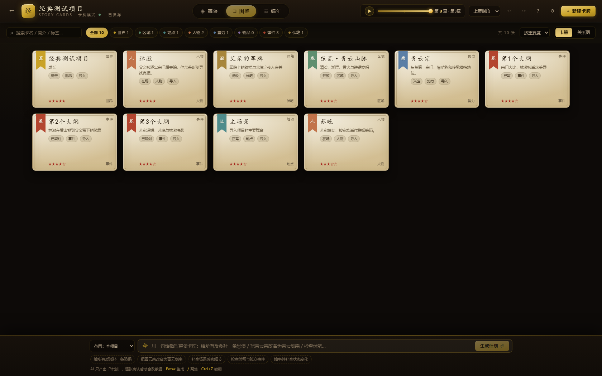

# 故事卡牌模式（Story Cards）

> 从 `storycard-demo` 整合进 MuMuAINovel 的新创作模式：把小说的世界、人物、事件、伏笔显性化成可编辑的卡牌与关系图，再投影成章节施工图。
> 原模式（世界/职业/角色/大纲/章节）完整保留，两种模式通过项目级 `creation_mode` 区分。

| 舞台 | 图鉴 |
|---|---|
|  |  |

| 编年 | 一句话指令 → 计划 |
|---|---|
|  |  |

---

## 1. 两种模式

| | 原模式 `classic` | 故事卡牌模式 `storycard` |
|---|---|---|
| 数据 | 世界设定、职业、角色、组织、关系、大纲、章节、伏笔 | 卡牌、类型化边、故事链、章节位置快照 |
| 入口 | 书架 → 快速开始 / 灵感模式 | 书架 → 卡牌模式 |
| 工作台 | 传统侧边栏页面 | `/project/:projectId/storycard` 全屏工作台 |
| 写作 | 原有生成/分析/导出流程 | 目前聚焦「卡牌 → 大纲/施工图」结构层，正文写作仍走原模式章节页 |
| 项目落点 | `/project/:id` → 赞助/项目页 | `/project/:id` → 自动进入卡牌工作台 |

- 新建卡牌项目时 `wizard_status` 直接标记为 `completed`，不会再进入四步向导。
- 书架卡片会显示「原模式 / 卡牌模式」标签。
- 卡牌项目点「←」会回到原模式的章节管理页，原模式数据与页面保持可用。

### 从原模式转换

在卡牌工作台的「设置 → 从原模式导入」或首次进入的引导页中，可以把当前项目一键转成卡牌：

| 原模式数据 | 转成 |
|---|---|
| `Project.world_*` | 世界卡 + 区域卡 + 默认地点卡 |
| `Character`（人物） | 人物卡（欲望/恐惧/缺陷/谎言从性格/背景里尽量抽取） |
| `Character`（组织） + `Organization` | 势力卡 |
| `CharacterRelationship` | `relation` 边 |
| `OrganizationMember` | `belongs` 边 |
| `Outline.structure` | 事件卡 + 主线链 + 因果边 |
| `Chapter` | 卡牌章节 + 位置快照（默认把人物放在主场景） |
| `Foreshadow` | 伏笔卡（含关联人物的 `secret` 边） |

转换会保留原模式数据，只把项目 `creation_mode` 切到 `storycard`；不会删除 `characters/outlines/chapters` 等表。
再次导入时选择覆盖即可重新生成卡牌（会重建 cards/edges/chains/chapters）。

---

## 2. 工作台功能

### 舞台（Stage）
- 世界层：世界卡 HUD + 区域节点 + 区域间的通行/秘道边。
- 区域层：地点卡、按当前章节快照摆放的人物卡、未收事件 chip。
- 把人物卡拖到地点上 = 生成一张「移动事件卡」，并更新该章及之后章节的位置快照；不会直接改人物字段。
- 顶栏时间轴切章；POV 过滤会弱化其他人物。

### 图鉴（Codex）
- 卡册：搜索、类型筛选、重要度/名称/类型/更新时间排序。
- 关系图：按卡类型分列、按边类型着色，点击节点打开右栏。
- 新建、复制、删除（级联清理边、链、章节引用）。

### 编年（Chronicle）
- 横向时间轴 × 链泳道；事件因果边 / 伏笔边 / 章节带。
- 已写、已规划、当前章三种状态；时间轴回放。
- 图表由事件卡的 `order` / `chapter` / `chainIds` 决定。

### 右栏编辑
- 按卡类型渲染字段组（人物四件套、事件 delta、区域感官细节……）。
- 字段级 AI：改写 / 补全 / 换一版，先出 diff，采纳才写回。
- 补全缺失、联想关联、反向链接、版本历史回滚。
- AI 使用 MuMuAINovel「API 设置」中的模型；未配置或调用失败自动回退本地 Mock，不阻塞编辑。

### 底部指令栏
- 范围：全项目 / 当前章相关 / 当前选中卡。
- 四类指令：确定性改名、创意批量（补恐惧、补感官、补动机、补 delta）、巡检报告、兜底润色。
- 固定流程：**计划 → 逐卡 diff → 勾选 → 应用**；应用后可 `Ctrl+Z` 撤销。
- 指令规划默认走本地规则；设置里可切「AI 模型（实验）」，失败回退本地规则。

### 自动保存与撤销
- 工作区以文档方式同步：`PUT /api/storycard/projects/{id}`，700ms 防抖，`Ctrl+S` 立即保存。
- 服务端用 `projects.storycard_revision` 做乐观锁；版本不一致返回 409，避免两个窗口静默覆盖。
- 撤销/重做是前端 50 步快照栈，不落库。

---

## 3. 数据与接口

### 数据表

| 表 | 说明 |
|---|---|
| `story_cards` | 统一卡表：`card_type` + 公共字段 + `fields` JSON + `history` JSON |
| `story_card_edges` | 类型化有向边：relation/causes/belongs/controls/owns/path/secret |
| `story_chains` | 故事链与有序事件 id |
| `story_chapters` | 章节施工图、章节内事件、人物位置快照、可选 `chapter_id` |
| `projects.creation_mode` | `classic` / `storycard` |
| `projects.storycard_revision` | 工作区版本号（乐观锁） |

### 工作区 JSON

`GET /api/storycard/projects/{projectId}` 返回：

```jsonc
{
  "version": 1,
  "projectId": "...",
  "title": "苍梧卷",
  "genre": "玄幻",
  "theme": "……",
  "premise": "……",
  "creationMode": "storycard",
  "revision": 3,
  "cards": [
    {
      "id": "c1", "type": "character", "name": "林澈",
      "aliases": [], "oneLiner": "...", "summary": "...", "body": "...",
      "tags": [], "importance": 0.95, "status": "present",
      "fields": { "desire": "...", "fear": "...", "flaw": "...", "lie": "..." },
      "history": [], "meta": {}, "chainIds": [],
      "createdAt": 0, "updatedAt": 0
    }
  ],
  "edges": [{ "id": "e1", "from": "c1", "to": "c2", "type": "relation", "label": "青梅", "strength": 55 }],
  "chains": [{ "id": "chain-1", "name": "复仇主线", "kind": "主线", "eventIds": [] }],
  "chapters": [{ "id": "ch1", "number": 1, "title": "开篇", "eventIds": [], "locations": {} }],
  "classic": { "characters": 0, "outlines": 0, "chapters": 0, "foreshadows": 0, "hasContent": false }
}
```

### API

| 方法 | 路径 | 作用 |
|---|---|---|
| GET | `/api/storycard/projects/{id}` | 读取工作区 |
| PUT | `/api/storycard/projects/{id}` | 整包保存（带 revision） |
| POST | `/api/storycard/projects/{id}/import` | 从原模式导入/覆盖 |
| GET | `/api/storycard/ai/status` | 当前用户 AI 是否配置 |
| POST | `/api/storycard/projects/{id}/ai/assist` | 字段级 AI |
| POST | `/api/storycard/projects/{id}/ai/complete` | 补全缺失字段 |
| POST | `/api/storycard/projects/{id}/ai/relations` | 联想关联 |
| POST | `/api/storycard/projects/{id}/ai/plan` | AI 指令规划 |

所有接口都校验 `request.state.user_id` 与项目归属。

---

## 4. 安装与迁移

### 数据库

SQLite（本地推荐）：

```bash
cd backend
alembic -c alembic-sqlite.ini upgrade head
```

PostgreSQL：

```bash
cd backend
alembic -c alembic-postgres.ini upgrade head
```

新增迁移：`20261026_storycard`（SQLite / PostgreSQL 各一份）。

### 前端依赖

新增 `framer-motion`、`clsx`、`immer`：

```bash
cd frontend
npm install
npm run build
```

### 开发

```bash
# 后端
cd backend
uvicorn app.main:app --host 127.0.0.1 --port 8000

# 前端
cd frontend
npm run dev   # http://127.0.0.1:5173
```

> Windows + Git Bash 下如果 ChromaDB 报 `unable to open database file`，把 `TEMP/TMP/SQLITE_TMPDIR` 指到工作区目录再启动即可（这是 Chroma Rust 绑定对 `/tmp` 路径的兼容问题，不是本项目数据问题）。

---

## 5. 已知边界

- 卡牌模式目前不直接生成正文；「事件卡 → 章节施工图 → 正文」的完整闭环是下一阶段。
- 原模式 → 卡牌是单向转换；转回原模式不会自动把卡牌写回 `characters/outlines`。
- 卡牌 id 是全局主键。示例数据会按项目 id 命名空间化；自定义 JSON 导入若复用短 id，会被后端拒绝并提示。
- AI 指令规划是实验能力；默认本地规则，生产使用建议先保持默认。
- 移动端未针对全屏工作台适配，建议桌面端使用。

---

## 6. 代码位置

```
backend/app/models/storycard.py             # 四张表
backend/app/schemas/storycard.py            # 工作区/卡牌/边/链/章节
backend/app/services/storycard_service.py   # 序列化、保存、原模式导入
backend/app/api/storycard.py                # 工作区 + AI 接口
backend/alembic/{sqlite,postgres}/versions/ # 20261026_storycard
frontend/src/storycard/                     # demo 迁移后的完整工作台
frontend/src/storycard/StoryCardWorkspace.tsx # 页面入口/加载/自动保存
frontend/src/components/StoryCardCreateModal.tsx
```
